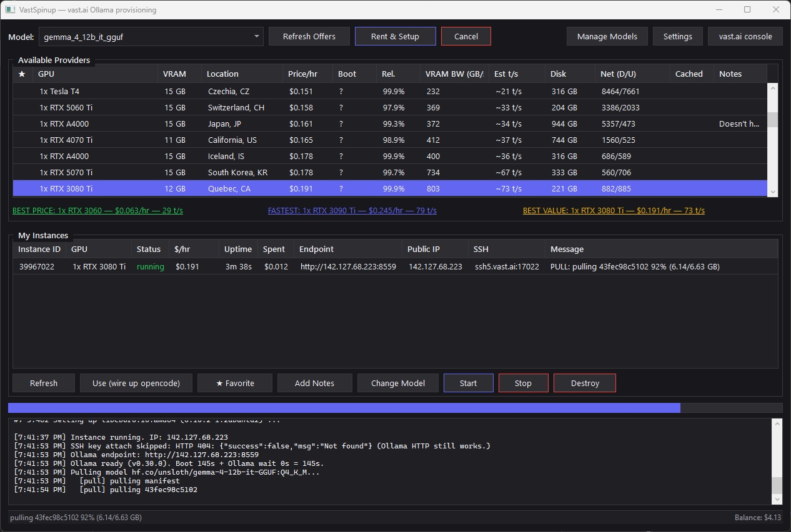
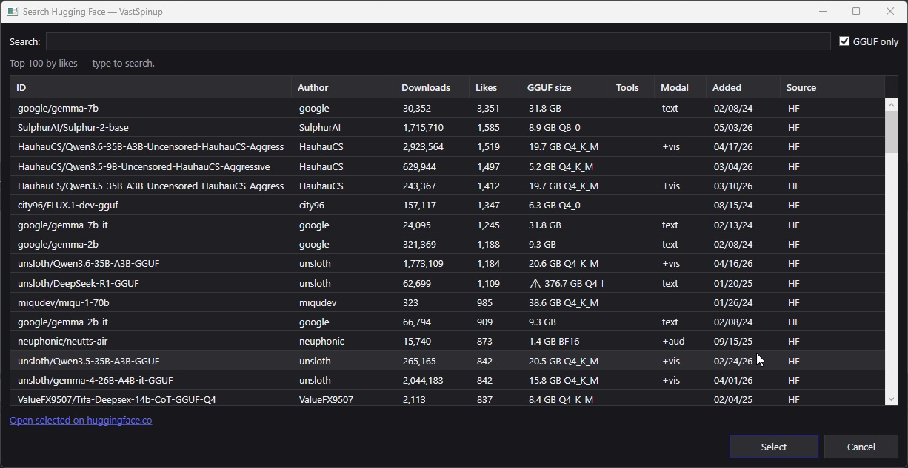
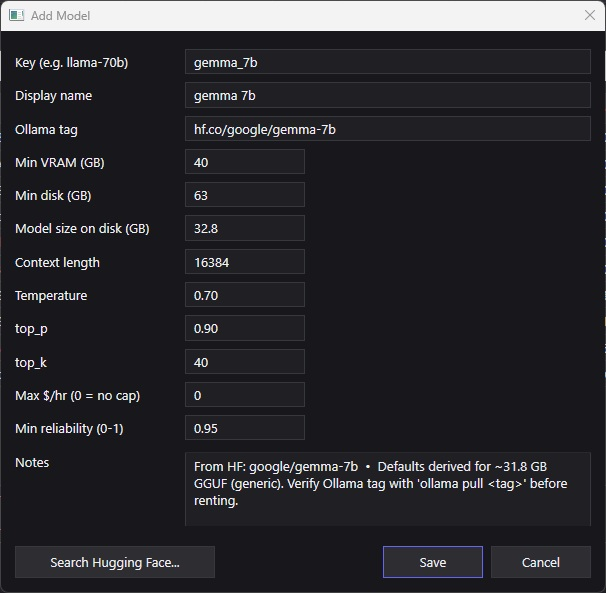

# VastSpinup

WPF desktop app for provisioning [vast.ai](https://vast.ai) GPU instances pre-loaded with
[Ollama](https://ollama.com) and wiring them up to local [OpenCode](https://opencode.ai) workflows.

Click an offer → rent → wait while it pulls the model → use a remote LLM from your editor
as if it were local. The app keeps history (host stats, favorites, per-machine notes) so
repeat rentals are faster and you remember which hosts behaved badly.



## What it does

- **Search vast.ai offers** filtered by VRAM, disk, reliability, and a per-model "fit" check.
- **Rank** offers three ways: best price, fastest, and best value (`t/s² ÷ $/hr` so cheap-but-slow
  hosts don't dominate).
- **Spin up** an instance running `vastai/ollama:0.30.0`, wait for boot, attach an ephemeral SSH
  key, wait for the Ollama daemon, pull the model, smoke-test it, and check capabilities.
- **Categorize smoke failures** so you know whether the host is broken (different offer needed),
  the model is incompatible (different model needed), or only multimodal projection failed
  (text-only models will still work on this host).
- **Change Model** on a running instance without rebuilding it — unloads → deletes → pulls new →
  smoke-tests. Multimodal-incompatible hosts hide multimodal models from the picker.
- **Persist history** across runs: favorites, per-host boot stats (`✓` warm / `✗` known-slow / blank
  unknown in the offers Cached column), free-form notes per machine, and the most recent
  Ollama template hash.
- **Search HuggingFace + Ollama library** with size, modality, and tools-capability enrichment so
  you can add new models confidently. Top 100 by likes loads by default.

### Add a model from HuggingFace

The HF search dialog pre-loads the 100 most-liked GGUF repos so you land on something useful,
then auto-derives the Ollama tag, model size, recommended sampling params, modality
(`text`/`+vis`/`+aud`/`+v/a`/`multi`), and tools-capability cross-reference from the Ollama library:



The picked metadata flows into the model edit dialog, pre-populating every field so you only
edit what you want to override:



## Quick start

```powershell
# Requires .NET 8 SDK + Windows 10/11.
dotnet build VastSpinup.sln
dotnet run --project VastSpinup.Wpf
```

First run: open **Settings** → paste your vast.ai API key → **Test** → **Save**. You'll see
your balance in the status bar once auth succeeds.

The app reads/writes only under `%USERPROFILE%\.config\vast-spinup\` plus the standard
opencode config under `%USERPROFILE%\.config\opencode\`. Nothing else on disk.

## Build a standalone binary

```powershell
dotnet publish VastSpinup.Wpf -c Release -r win-x64 --self-contained true `
    -p:PublishSingleFile=true `
    -p:IncludeNativeLibrariesForSelfExtract=true `
    -p:PublishReadyToRun=true `
    --output publish/win-x64
```

Produces a single `VastSpinup.Wpf.exe` (~170 MB, includes the .NET 8 runtime) at
`publish/win-x64/`. Same artifact that GitHub Actions builds on every push and attaches to
GitHub Releases on `v*` tag pushes.

## Tests

```powershell
dotnet test VastSpinup.sln
```

The test project covers the pure decision logic that's load-bearing for correctness:

- `SmokeClassifier` — categorizes llama-server stderr into BrokenHost / BrokenModel /
  MultimodalIncompatible / Unknown / Ok.
- `OfferRanking` — best price / fastest / best value with the `t/s² ÷ $/hr` formula.
- `ModalityHelper` — HF `pipeline_tag`/`tags` + Ollama capabilities → modality label.
- `GgufHelpers` — quant preference, shard aggregation, imatrix-file filtering.

49 tests, ~20 ms total.

## Layout

```
VastSpinup.sln
├── VastSpinup.Wpf/            ← app (WPF, .NET 8)
│   ├── App.xaml(.cs)          ← global exception handlers wire AppLog
│   ├── MainWindow.xaml(.cs)
│   ├── AppPaths.cs            ← all on-disk paths
│   ├── Themes/Dark.xaml       ← dark theme (brushes + styles)
│   ├── Mvvm/                  ← hand-rolled ObservableObject + RelayCommand
│   ├── ViewModels/            ← MainViewModel, OfferRowVM, InstanceRowVM
│   ├── Dialogs/               ← Notes, Settings, ChangeModel, ManageModels, ModelEdit, HuggingFaceSearch
│   ├── Models/                ← VastOffer, VastInstance, ModelEntry, GpuBlocklist
│   ├── Services/              ← Vast/Ollama/HuggingFace APIs, persistence, AtomicJson, AppLog,
│   │                            SmokeClassifier, OfferRanking, ModalityHelper, GgufHelpers
│   └── Converters/            ← BoolToVisibility, NullToVisibility, InstanceStatusToBrush
└── VastSpinup.Tests/          ← xUnit; pure-logic coverage
```

## On-disk state

| File | Purpose |
|---|---|
| `~/.config/vast-spinup/models.json` | Model registry (editable via Manage Models) |
| `~/.config/vast-spinup/favorites.json` | Set of favorited machine IDs |
| `~/.config/vast-spinup/host-stats.json` | Per-machine boot + Ollama-ready averages |
| `~/.config/vast-spinup/host-notes.json` | Free-form notes per machine |
| `~/.config/vast-spinup/ollama-template-hash.json` | Captured vast.ai template hash |
| `~/.config/vast-spinup/logs/app.log` | Diagnostic log (auto-rotated at ~2 MB) |
| `~/.config/vastai/vast_api_key` | API key (matches vast.ai CLI's location) |
| `~/.config/opencode/opencode-remote.json` | Written by **Use (wire up opencode)** |

All JSON writes go through `AtomicJson` (tmp file + atomic rename + per-path lock). Reads
and writes that fail are logged to `app.log` with file and exception details.

## License

[MIT](LICENSE) © cpaec
